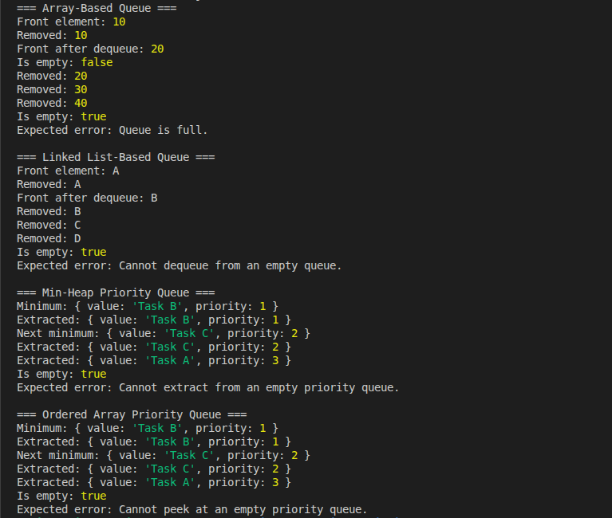

# GMC-implementation-variations-and-trade-offs-

## 1. Project Overview

The objective of this checkpoint is to implement and compare different data structures using JavaScript.

Four implementations are developed:

1. Array-based Queue (fixed size)
2. Linked List-based Queue (dynamic size)
3. Min-Heap-based Priority Queue
4. Ordered Array-based Priority Queue

Although these data structures provide similar functionality, their implementations have different performance characteristics, memory requirements, and limitations.

The goal is to understand these trade-offs and determine which implementation is best suited to different situations.

---

## 2. Queue Implementations

A queue is a data structure that follows the **FIFO (First In, First Out)** principle.

This means that the first element inserted is the first element removed.

For example, if we enqueue `10`, `20`, and `30`, the first element dequeued will be `10`.

Both queue implementations provide the following operations:

- `enqueue(element)`: Adds an element to the end of the queue.
- `dequeue()`: Removes and returns the front element.
- `peek()`: Returns the front element without removing it.
- `isEmpty()`: Checks whether the queue is empty.

### 2.1 Array-Based Queue

The array-based queue uses a fixed-size array to store its elements.

A circular array is used to avoid shifting all the remaining elements after each dequeue operation.

The queue maintains:

- `front`: The index of the next element to remove.
- `rear`: The index where the next element will be inserted.
- `size`: The number of elements currently in the queue.
- `capacity`: The maximum number of elements the queue can hold.

The circular structure allows the queue to reuse empty positions at the beginning of the array.

**Advantages:**

- Efficient use of a preallocated array.
- Constant-time insertion and removal.
- No need to allocate a separate node for every element.

**Disadvantages:**

- Has a fixed capacity.
- Cannot accept more elements when full.
- Requires careful management of the front and rear positions.

**Time complexity:**

| Operation   | Complexity |
| ----------- | ---------- |
| `enqueue()` | O(1)       |
| `dequeue()` | O(1)       |
| `peek()`    | O(1)       |
| `isEmpty()` | O(1)       |

The allocated array uses O(n) space, where `n` is its capacity.

### 2.2 Linked List-Based Queue

The linked list-based queue uses a singly linked list to store elements.

Each node contains:

- `value`: The stored element.
- `next`: A reference to the next node.

The queue maintains references to the front and rear nodes.

When an element is added, a new node is attached to the rear. When an element is removed, the front reference moves to the next node.

Unlike the array-based queue, the linked list-based queue does not have a predefined capacity.

**Advantages:**

- Dynamically grows as elements are added.
- Does not require a fixed capacity.
- Supports constant-time insertion and removal.

**Disadvantages:**

- Each node requires additional memory for its next reference.
- Allocates new nodes when elements are inserted.
- Uses more memory per element than a simple array of references.

**Time complexity:**

| Operation   | Complexity |
| ----------- | ---------- |
| `enqueue()` | O(1)       |
| `dequeue()` | O(1)       |
| `peek()`    | O(1)       |
| `isEmpty()` | O(1)       |

The queue uses O(n) space for `n` elements.

### 2.3 Which Queue Implementation Is Better?

Neither implementation is universally better. The choice depends on the requirements.

The **array-based queue** is a good choice when the maximum number of elements is known in advance. Its circular structure provides efficient operations while avoiding repeated memory allocations for individual nodes.

The **linked list-based queue** is more suitable when the number of elements changes dynamically and a fixed capacity would be restrictive.

Both implementations offer O(1) insertion and removal in this project.

The main difference is that the array-based queue has a fixed capacity, whereas the linked list-based queue grows dynamically.

---

## 3. Priority Queue Implementations

A priority queue is a data structure in which elements are processed according to their priority rather than their insertion order.

In this project, each element is represented by an object containing a value and a numeric priority.

For example:

```javascript
{ value: "Task A", priority: 3 }
```

## Tests


